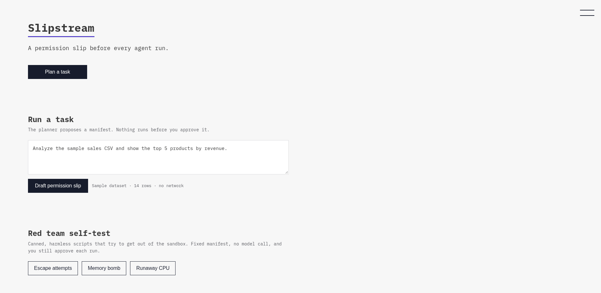
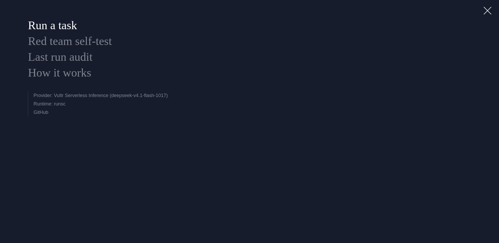
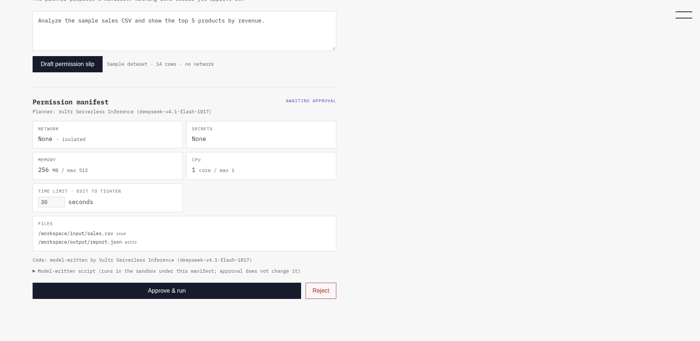
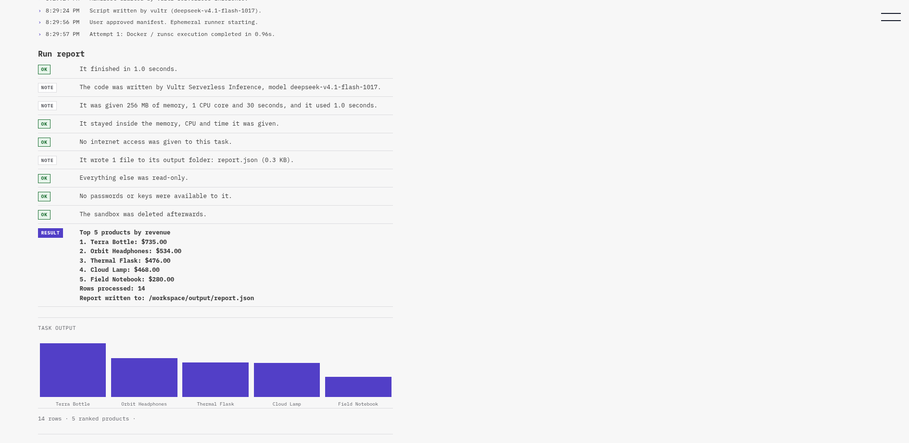
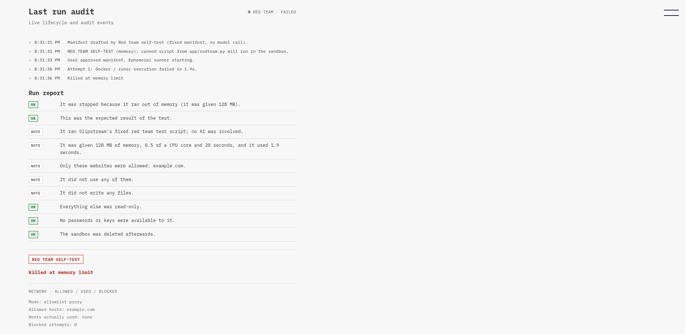
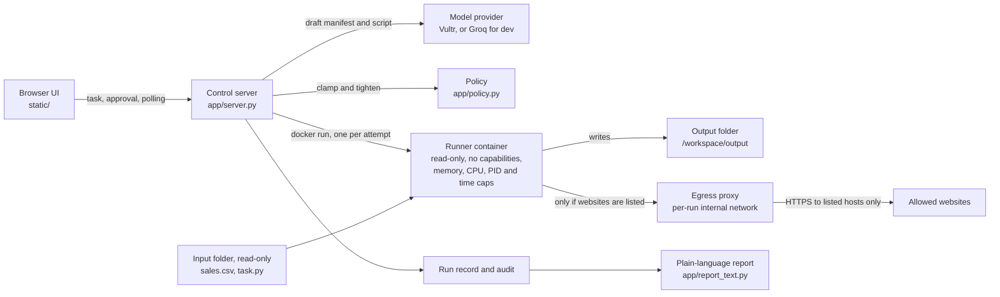

# Slipstream

**A permission slip before every agent run.**

[](LICENSE)


**[Live demo: https://45.76.80.14.sslip.io/](https://45.76.80.14.sslip.io/)**



## Table of contents

- [What it is](#what-it-is)
- [Key features](#key-features)
- [Screenshots](#screenshots)
- [Architecture](#architecture)
  - [Request lifecycle](#request-lifecycle)
  - [Components](#components)
  - [Security model](#security-model)
- [Quick start (local)](#quick-start-local)
  - [Prerequisites](#prerequisites)
  - [Install and run](#install-and-run)
  - [API keys are optional](#api-keys-are-optional)
  - [Try it](#try-it)
  - [Run the tests](#run-the-tests)
  - [Optional: Docker Compose (local experiments only)](#optional-docker-compose-local-experiments-only)
  - [Troubleshooting](#troubleshooting)
- [Live demo](#live-demo)
- [Project structure](#project-structure)
- [Tech stack](#tech-stack)
- [Limitations and next steps](#limitations-and-next-steps)
- [Credits](#credits)
- [License](#license)

## What it is

**The problem.** AI agents increasingly write and run code. Usually that code runs with whatever access the agent's host has: the network, files, environment variables holding API keys, and no real limit on memory or time. One bad plan or prompt injection can do a lot of damage.

**The idea.** Slipstream puts a permission slip in front of every run:

1. **Plan.** A model (or a built-in planner) turns the task into a manifest: which files, how much memory, CPU and time, which websites, and no secrets.
2. **Bound.** Fixed server-side policy rules clamp that manifest. The model can suggest, but it cannot widen anything.
3. **Approve.** Nothing runs until a person approves the slip. Approval can only tighten it.
4. **Run.** The code runs in a throwaway, locked-down Docker container that enforces the slip.
5. **Report.** A plain-language report says what the run was given, what it used, what was blocked, and that the container was removed.

Slipstream was built for the Vultr Agent Rush hackathon on lablab.ai, for the "Blast Radius Zero" challenge.

## Key features

- **Permission manifest with hard caps.** `app/policy.py` builds every manifest itself: memory 64 to 512 MB, CPU 0.25 to 1 core, time 5 to 60 seconds, a fixed file list, and an empty secrets list. Model output is only a suggestion; the policy decides.
- **Approval can only tighten.** The approve endpoint accepts lower memory, CPU or time and a subset of the listed websites. Anything wider is rejected, and approval cannot supply or change code.
- **Model-written code with retries.** With a provider key, the model writes a standard-library Python script for the task. If it fails or times out, the model gets the error output and writes a fix, for up to 2 retries (3 attempts), each in a fresh container with identical limits.
- **Per-task website allowlist.** A manifest can list up to 5 websites (no wildcards, IP addresses, localhost or internal names). When it does, the runner sits on a per-run Docker `--internal` network whose only way out is an egress proxy that allows HTTPS `CONNECT` on port 443 to listed hosts only, and refuses hosts that resolve to private, loopback, link-local or cloud metadata addresses. With no websites listed, the runner gets `--network none`.
- **Hardened containers.** The runner is started with `--read-only`, `--cap-drop ALL`, `--security-opt no-new-privileges`, `--pids-limit 64`, `--memory` equal to `--memory-swap` (no swap), `--cpus`, a `noexec,nosuid` 32 MB `/tmp` tmpfs, a read-only input mount and a writable output folder. It runs as a non-root user. `SANDBOX_RUNTIME=runsc` adds gVisor.
- **Ephemeral by default.** Every attempt runs in a new `--rm` container. Proxies and networks are removed after the run, and labelled leftovers from an interrupted run are cleaned up when the server starts.
- **Red Team self-test.** Three canned, harmless scripts check the sandbox: escape attempts (unlisted website, raw socket, writes outside the output folder, secret lookup), a memory bomb and a runaway CPU loop. They use a fixed manifest and still need approval.
- **Plain-language run report.** Short sentences built only from the run record, with the raw attempts, stdout and audit JSON in a collapsed "Technical details" view.
- **Provider switch.** Vultr Serverless Inference is the submission provider; Groq is supported for local development and labelled "DEV ONLY" in the UI. `REQUIRE_VULTR=true` refuses every other provider and stops the server from starting without a Vultr key.
- **Public demo protections.** A cap on concurrent runs, per-IP rate limits, task and request size caps, and a daily cap on model calls.

## Screenshots

<table>
  <tr>
    <td width="50%">
      
      <br><sub>Landing view: describe a task or start a Red Team self-test.</sub>
    </td>
    <td width="50%">
      
      <br><sub>Overlay menu, showing the active model provider and container runtime.</sub>
    </td>
  </tr>
  <tr>
    <td width="50%">
      
      <br><sub>Permission slip: the manifest to approve, with the model-written script collapsed below it.</sub>
    </td>
    <td width="50%">
      
      <br><sub>Plain-language report and chart after a successful run.</sub>
    </td>
  </tr>
  <tr>
    <td width="50%">
      
      <br><sub>Red Team memory bomb: stopped at its 128 MB memory limit.</sub>
    </td>
    <td width="50%"></td>
  </tr>
</table>

## Architecture



### Request lifecycle

1. **Plan.** The browser sends the task (up to 1000 characters) to `POST /api/plan`. If a provider is configured and the daily cap is not reached, the model drafts a manifest as JSON; on any error the built-in planner is used. `app/policy.py` then builds the real manifest from the draft. The model is also asked for one Python script; if that fails, the plan falls back to the built-in analysis program. The plan is stored in memory under a random ID with the state `awaiting_approval`.
2. **Approve.** `POST /api/approve` takes that ID plus optional tighter values. The server rejects anything wider than the issued manifest, any attempt to send code, and new runs beyond `MAX_CONCURRENT_RUNS` (HTTP 429, the plan stays awaiting approval).
3. **Run.** A background thread creates fresh temporary input and output folders, copies in the sample CSV (and the script, if there is one), and starts the hardened runner container. If the manifest lists websites, it first creates an `--internal` network and a proxy container for that run. The host kills the container when the time limit passes.
4. **Retry.** If a model-written script fails or times out, the model receives the previous script and the last 2000 characters of its error output and returns a corrected script. That runs in a new container with the same limits. There are at most 3 attempts.
5. **Report.** The audit is built from the limits actually passed to Docker and the proxy's log of allowed and blocked connections. `app/report_text.py` turns it into plain sentences. The UI polls `GET /api/runs/<id>` to show events and the report.
6. **Cleanup.** The runner is started with `--rm`, the proxy and network are removed after each run, and the temporary folders are deleted. On startup the server removes any containers and networks labelled `slipstream=1` that an interrupted run left behind.

### Components

| File or folder | Responsibility |
| --- | --- |
| `app/server.py` | HTTP API and static file server, planning, approval, run thread, retries, audit, rate limits |
| `app/policy.py` | Builds the manifest from a draft and applies tighten-only approval edits |
| `app/llm.py` | OpenAI-compatible chat client for Vultr and Groq, `REQUIRE_VULTR` guard, daily call cap |
| `app/codegen.py` | Prompt for model-written scripts and extraction of the single code block |
| `app/runner.py` | Docker runner with hardened flags, per-run proxy and network, stale cleanup |
| `app/redteam.py` | Red Team scenarios: fixed manifests, canned scripts and the escape scorecard |
| `app/report_text.py` | Plain-language report built only from the run record |
| `proxy/` | Standard-library HTTPS `CONNECT` proxy that enforces the website allowlist |
| `sandbox/` | Runner image and the built-in CSV analysis program (`analyze.py`) |
| `static/` | Single-page UI (HTML, CSS, vanilla JavaScript) |
| `examples/sales.csv` | The 14-row sample dataset every run reads |
| `deploy/` | Setup script, systemd unit, Caddyfile and env template for the Vultr VM |
| `tests/` | pytest suite |

### Security model

**What is enforced**

- The model only drafts. The policy fixes the file list, keeps secrets empty, caps resources and filters website names. The model never sets Docker flags.
- Runs need an explicit approval of a server-issued manifest ID, and approval can only narrow the manifest.
- Model-written code only runs inside Docker. The container is the security boundary; the code is not checked for safety.
- The runner has a read-only root file system, no Linux capabilities, `no-new-privileges`, a non-root user, PID, memory, swap, CPU and time limits, and a single writable output folder.
- Network is off (`--network none`) unless the manifest lists websites. Then all traffic must go through the per-run proxy, which allows HTTPS to those hosts only and logs every allowed and blocked connection.
- API keys stay in the control server process. The runner container receives no host environment variables, only the proxy settings when websites are listed.

**Honest limits**

- This is a single-user hackathon demo. There are no user accounts; anyone who can reach the server can plan and approve runs.
- With Docker's default runtime (runc), containers share the host kernel. Docker isolation is not equivalent to gVisor or a microVM. Set `SANDBOX_RUNTIME=runsc` with gVisor installed for a stronger boundary.
- The control server drives Docker, so access to the Docker daemon is root-equivalent on the host. The Compose setup mounts the Docker socket into the control container, which gives that container root-equivalent access to the host.
- Runs are stored in memory only (the newest 200 from the last 2 hours) and are lost on restart.
- The runner image has the Python standard library only. Model-written scripts cannot use pandas, numpy or other packages.
- The "used" section of the report comes from the runner result, output folder and proxy logs. It is not kernel-level telemetry.

## Quick start (local)

The direct Python run below is the verified path. Docker Compose is covered afterwards as an optional local experiment.

### Prerequisites

- Git
- Python 3.11 or newer
- Docker Engine, usable without `sudo`

On Linux, check that `docker info` works as your normal user. If it only works with `sudo`, add yourself to the `docker` group and start a new shell:

```shell
sudo usermod -aG docker "$USER"
newgrp docker
docker info
```

Membership of the `docker` group is root-equivalent on that machine, so only do this on a machine you control.

**Platform note.** Slipstream was developed and tested on Fedora Linux. macOS (with Docker Desktop) and Windows with WSL2 should work, but they are untested.

### Install and run

1. Clone the repository:

   ```shell
   git clone https://github.com/ChiefMinister420/Vultr-Hackathon.git slipstream
   cd slipstream
   ```

2. Create and activate a virtual environment:

   ```shell
   python3 -m venv .venv
   source .venv/bin/activate
   ```

3. Install the project with its development tools:

   ```shell
   pip install -e '.[dev]'
   ```

4. Create your local settings file from the template, with the port filled in:

   ```shell
   sed 's/^PORT=$/PORT=8080/' .env.example > .env
   ```

   This is `.env.example` with `PORT=8080` set. A plain `cp .env.example .env` leaves `PORT=` empty, and the server currently refuses to start with an empty `PORT`.

5. Build the runner image:

   ```shell
   docker build -t slipstream-runner:local -f sandbox/Dockerfile .
   ```

6. Build the egress proxy image (used by runs that list websites, such as the Red Team escape test):

   ```shell
   docker build -t slipstream-proxy:local -f proxy/Dockerfile .
   ```

7. Start the server:

   ```shell
   python -m app.server
   ```

8. Open http://127.0.0.1:8080 in your browser.

To check the server from a terminal:

```shell
curl -s http://127.0.0.1:8080/api/health
```

`"docker_ready": true` means runs can execute. Without Docker the UI still loads, but no task is run.

### API keys are optional

With no key, the built-in planner drafts the manifest and the fixed analysis program `sandbox/analyze.py` runs. It always computes the top 5 products by revenue, whatever the task text says. With a Vultr or Groq key, the model drafts the manifest and writes the code that runs.

Set keys in `.env` (never commit it; it is in `.gitignore`). The provider settings from `.env.example`:

```shell
# Vultr Serverless Inference key: the submission provider.
VULTR_INFERENCE_API_KEY=
# Vultr model. Empty: deepseek-v4.1-flash-1017
VULTR_INFERENCE_MODEL=
# Groq key, for local development only.
GROQ_API_KEY=
# vultr or groq. Empty: vultr if its key is set, else groq if its key is set, else the built-in planner.
LLM_PROVIDER=
# Overrides the provider's default model (Groq default: openai/gpt-oss-120b).
LLM_MODEL=
# Groq gpt-oss models only: low, medium or high. Empty: low for planning, medium for code.
LLM_REASONING_EFFORT=
# true: allow only vultr, and refuse to start without VULTR_INFERENCE_API_KEY.
REQUIRE_VULTR=
# Token budget for model-written scripts (reasoning plus code). Empty: 3000
LLM_CODE_MAX_TOKENS=
```

- `LLM_PROVIDER` picks the provider. Left empty, Slipstream uses Vultr if `VULTR_INFERENCE_API_KEY` is set, otherwise Groq if `GROQ_API_KEY` is set, otherwise the built-in planner.
- `REQUIRE_VULTR=true` is for the submission deployment. Any provider other than `vultr` is refused, and the server exits at startup if `VULTR_INFERENCE_API_KEY` is missing. `/api/health` reports the provider, the model and whether this guard is on.

The other settings in `.env.example`:

| Variable | Default when empty | Purpose |
| --- | --- | --- |
| `SANDBOX_RUNTIME` | Docker's default runtime | Container runtime for runs, for example `runsc` for gVisor |
| `HOST` | `127.0.0.1` | Bind address |
| `PORT` | `8080` | Port |
| `TRUST_PROXY` | off | `true` only behind a reverse proxy that sets `X-Forwarded-For` |
| `ALLOWED_ORIGIN` | same-origin only | One cross-origin site allowed to call the API |
| `MAX_CONCURRENT_RUNS` | `2` | Approved runs executing at once |
| `RATE_LIMIT_PER_MIN` | `10` | Plans per minute per client IP; all limited requests together get twice this |
| `MAX_LLM_CALLS_PER_DAY` | `300` | Model calls per UTC day; after that, plans use the built-in planner |

Values already set in your shell environment take precedence over `.env`.

### Try it

1. **Sample CSV task (no key needed).** Keep the default task "Analyze the sample sales CSV and show the top 5 products by revenue.", click **Draft permission slip**, review the slip and click **Approve & run**. The report, chart and audit appear under "Last run audit".
2. **Red Team escape test (no key needed).** Click **Escape attempts** and approve. The scorecard should show the unlisted website, the raw socket, the writes outside the output folder and the secret lookup as BLOCKED, and the output folder write and `example.com` as OK. This run reaches `example.com` through the proxy, so it needs internet access. **Memory bomb** and **Runaway CPU** show the memory and time limits stopping a run.
3. **A task that needs model-written code (requires a provider key).** For example: "Show the total revenue per day as a chart and name the best day." The built-in program cannot do this; with a key, the permission slip shows the model-written script before you approve it.

### Run the tests

```shell
pytest -q
ruff check .
```

### Optional: Docker Compose (local experiments only)

`docker-compose.yml` is for local experiments only and is not how the live demo is deployed. **It mounts the Docker socket into the control container, which gives that container root-equivalent access to your host.**

Build both sandbox images on the host first. Compose builds the runner image itself but not the proxy image, and the control container starts runs through the host's Docker daemon, which needs both:

```shell
docker build -t slipstream-runner:local -f sandbox/Dockerfile .
docker build -t slipstream-proxy:local -f proxy/Dockerfile .
docker compose up --build
```

Open http://127.0.0.1:8080, and stop the stack with:

```shell
docker compose down
```

Notes:

- Compose passes only the Vultr settings, `REQUIRE_VULTR` and `SANDBOX_RUNTIME` into the container. Groq is not wired up there.
- Run folders are shared through `/tmp/slipstream-compose` on the host.
- **Fedora and other SELinux systems:** if Docker runs with SELinux support enabled (`docker info` lists `selinux` under Security Options), SELinux can stop the control container from using the Docker socket, and `/api/health` then shows `"docker_ready": false`. As a local-only workaround, create a `docker-compose.override.yml` next to `docker-compose.yml` (Compose merges it automatically; do not commit it):

  ```yaml
  services:
    slipstream:
      security_opt:
        - label=disable
  ```

  This turns off SELinux separation for that container. Do not use it on a shared or public machine.

### Troubleshooting

| Symptom | Cause and fix |
| --- | --- |
| `permission denied while trying to connect to the Docker daemon socket`, or `"docker_ready": false` in `/api/health` | Your user cannot reach Docker. Make sure the daemon runs (`sudo systemctl enable --now docker`), then apply the `docker` group fix from [Prerequisites](#prerequisites). |
| Run fails with `Runner image slipstream-runner:local not found` or `Proxy image slipstream-proxy:local not found` | Build the missing image with the commands in steps 5 and 6. The proxy image is only needed by runs that list websites, such as the Red Team escape test. |
| Server exits at startup with `ValueError: invalid literal for int() with base 10: ''` | `PORT=` is empty in `.env`. Set `PORT=8080` (see step 4). |
| `OSError: [Errno 98] Address already in use` at startup | Something else uses port 8080. Find it with `ss -ltnp \| grep 8080`, or start on another port: `PORT=8081 python -m app.server`. |
| `docker build` fails pulling `python:3.12-alpine` with a DNS error such as `no such host` or `i/o timeout` | The Docker daemon cannot resolve Docker Hub. Check the host's DNS and network (VPNs often cause this). If the host resolves names but Docker does not, set `"dns"` servers in `/etc/docker/daemon.json` and restart Docker. |
| On Fedora, Compose shows `"docker_ready": false` while `docker info` works on the host | SELinux may be blocking the control container from using the Docker socket. See the SELinux note in the Compose section. The direct Python run labels its run folders for containers (`:Z` mounts) and was tested with SELinux in enforcing mode. |
| Server exits at startup with `LLM configuration error: REQUIRE_VULTR=true but VULTR_INFERENCE_API_KEY is not set.` | `REQUIRE_VULTR=true` is set without a Vultr key. Set `VULTR_INFERENCE_API_KEY`, or leave `REQUIRE_VULTR` empty for local development. |

## Live demo

**[https://45.76.80.14.sslip.io/](https://45.76.80.14.sslip.io/)**

What to try: the sample CSV task (on the live demo the model writes the script, which you can read on the permission slip before approving), then the three Red Team self-tests. Open the menu to see the active provider and runtime. At the time of writing, its `/api/health` endpoint reported Vultr Serverless Inference with the `deepseek-v4.1-flash-1017` model, the `runsc` (gVisor) runtime and `REQUIRE_VULTR` on.

Please note:

- It is a shared public demo with per-IP rate limits, a limit of 2 concurrent runs and a daily cap on model calls. After the cap, plans fall back to the built-in planner.
- It runs on a single Vultr VM paid for with hackathon credits and may be offline.
- Do not enter sensitive data. Tasks are sent to the model provider, and runs are visible to anyone who has the run ID.

How it is deployed (systemd, gVisor, Caddy, firewall): [docs/DEPLOY_VULTR.md](docs/DEPLOY_VULTR.md).

## Project structure

```text
.
├── app/
│   ├── server.py         HTTP API, planning, approval, runs, audit, rate limits
│   ├── policy.py         Manifest caps and tighten-only approval
│   ├── llm.py            Vultr and Groq chat client, REQUIRE_VULTR, daily cap
│   ├── codegen.py        Model-written script prompt and extraction
│   ├── runner.py         Hardened Docker runner, proxy and network setup, cleanup
│   ├── redteam.py        Red Team scenarios and scorecard
│   └── report_text.py    Plain-language run report
├── proxy/                Allowlisting HTTPS egress proxy and its image
├── sandbox/              Runner image and built-in CSV analysis program
├── static/               Web UI
├── examples/sales.csv    Sample dataset
├── deploy/               Vultr VM setup script, systemd unit, Caddyfile, env template
├── docs/                 Deployment runbook, notes and screenshots
├── tests/                pytest suite
├── Dockerfile            Control server image (Compose only)
└── docker-compose.yml    Local experiments only
```

## Tech stack

- **Backend:** Python 3.11+ standard library only (`http.server`, `urllib`, `subprocess`), with no runtime dependencies.
- **Sandbox:** Docker, with optional gVisor (`runsc`). Runner and proxy images are based on `python:3.12-alpine`.
- **Models:** Vultr Serverless Inference (OpenAI-compatible API); Groq for local development.
- **Frontend:** plain HTML, CSS and JavaScript, no build step.
- **Deployment:** Vultr Cloud Compute VM, systemd and Caddy (automatic HTTPS).
- **Tooling:** pytest, ruff and pre-commit.

## Limitations and next steps

Not built yet:

- **Live output streaming.** The UI polls the run record; output appears when an attempt finishes.
- **Your own data.** Every run reads the bundled sample CSV; there is no upload, and the file list in the manifest is fixed.
- **Persistent, signed audit log.** Runs live in memory and disappear on restart.
- **Accounts and multi-tenant isolation.** There is no login, and all users share one server.
- **Kernel-level telemetry.** The report does not measure actual memory, CPU or file access per process.
- **Websites for normal tasks in the UI.** The planner is instructed not to request network access, and the UI only lets you edit the time limit. In practice the website allowlist is exercised by the Red Team escape test.

## Credits

Built for the Vultr Agent Rush hackathon on lablab.ai ("Blast Radius Zero" challenge).

<!-- Team members: add names here. -->

## License

Released under the [MIT License](LICENSE).
